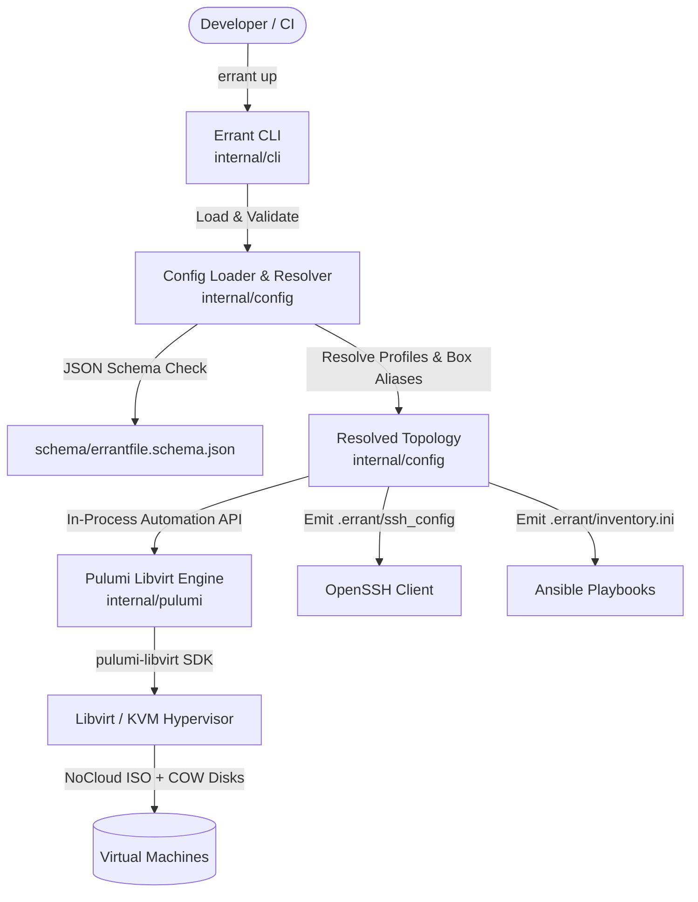

# AGENTS.md — Agent & Contributor Guidelines for Errant

Welcome to the **Errant** codebase. This document defines the architectural principles, repository conventions, toolchain commands, and coding invariants that human contributors and AI agents must follow when modifying or extending this project.

---

## 1. Project Mission & Overview

**Errant** is a modern, free-software (MIT) local virtual machine orchestrator designed as a declarative alternative to HashiCorp Vagrant in Linux/KVM environments.

### Why Errant Exists
* **Vagrant Deprecation**: HashiCorp has phased out the Vagrant Cloud public box registry and relicensed its stack under BSL 1.1.
* **Ruby Elimination**: Vagrant's Ruby runtime, C-extensions (`vagrant-libvirt`, `ruby-libvirt`, `fog-libvirt`), and fragile CLI scraping break constantly across host OS updates.
* **Declarative Foundation**: Rather than re-inventing a buggy hypervisor RPC engine or custom state tracker, Errant uses a clean, single-binary Go CLI frontend driving Libvirt/KVM via an in-process **Pulumi** engine (`pulumi-libvirt`) and local state tracking.
* **The Joy of Reinvention**: For the fun of exploring and reinventing an important piece of software that used to be a free companion of many hours of work.

---

## 2. System Architecture (Path B)



### Key Subsystems:
1. **Config Engine (`internal/config/`)**:
   - Embedded canonical JSON schema (`schema.json`).
   - Profile inheritance (`profiles:`) resolving default roles, sizing, disks, and provisioners.
   - Vagrant-style box shorthands (`box: ubuntu/noble64`, `debian/bookworm64`, `nixos/24.11`) resolving to canonical cloud images.
   - Topology expansion supporting index templating (`${index}`), auto-incrementing IPs (`ip_start`), and boolean conditions (`${index} == 1`).
2. **Execution Engine (`internal/pulumi/`)**:
   - Pure in-process Go Pulumi program driving `pulumi-libvirt` (`github.com/pulumi/pulumi-libvirt/sdk/go/libvirt`).
   - Automation API runner with zero-cloud local state (`file://.errant/state`).
   - Event streamer translating engine events into clean terminal logs.
   - Node lifecycle management (Apply, Destroy, Halt, Status).
3. **Artifact Generators (`internal/generator/`)**:
   - `ssh.go`: Generates `.errant/ssh_config` for seamless native OpenSSH access.
   - `inventory.go`: Generates `.errant/inventory.ini` mapping node roles to Ansible groups.
4. **CLI Layer (`internal/cli/`)**:
   - Cobra-based commands exposing the familiar Vagrant UX (`init`, `up`, `status`, `ssh`, `halt`, `destroy`, `ssh-config`, `inventory`, `validate`).
5. **Interactive Wizard (`internal/wizard/`)**:
   - Charmbracelet Bubble Tea & Lipgloss interactive TUI for generating schema-compliant `Errantfile.yaml` configurations across multiple archetypes (k8s-cluster, k8s-ha, single-vm, custom).

---

## 3. Repository Structure

```
/home/xeno/git/gitea/errant/
├── cmd/
│   └── errant/              # Alternative CLI entry point
│       └── main.go
├── internal/                # Private application packages (MANDATORY location)
│   ├── cli/                 # Cobra subcommands (init, up, status, ssh, halt, destroy, etc.)
│   ├── config/              # YAML parsing, validation, box aliases, and profile resolution
│   ├── generator/           # SSH config and Ansible inventory emitters
│   ├── provisioner/         # In-guest script, file, and mount provisioner
│   ├── pulumi/              # In-process Pulumi engine and Automation API runner
│   └── wizard/              # Charmbracelet Bubble Tea & Lipgloss interactive generator
├── schema/                  # Canonical Draft 2020-12 JSON Schema
│   └── errantfile.schema.json
├── examples/                # Reference topologies
│   └── k8s-homelab/         # Direct replacement for os76-ansible/k8s-homelab Vagrantfile
│       ├── Errantfile.yaml
│       └── scripts/
├── dist/                    # Compiled binary outputs (gitignored)
│   └── errant
├── .envrc                   # direnv integration (loads Nix shell)
├── .githooks/               # Managed git hooks configuration and check wrappers
├── .golangci.yml            # Strict linter configuration
├── .markdownlint-cli2.yaml  # Markdown linter configuration
├── .yamllint.yaml           # YAML linter configuration
├── build.sh                 # Standard build script
├── go.mod / go.sum          # Go dependencies
├── docs/                    # Architectural plans & design documentation
│   └── PLAN.md
├── main.go                  # Root application entry point
├── README.md                # User-facing documentation
└── shell.nix                # Nix development environment
```

---

## 4. Invariants & Rules for AI Agents

When working on this repository, all agents must adhere to the following rules:

1. **Package Placement (`internal/` only)**:
   - All Go code belonging to the application MUST be located in `internal/<package>`.
   - **NEVER** create a `pkg/` directory. The user explicitly mandated `internal/` for all internal modules.
2. **Zero Linter Warnings (`golangci-lint`)**:
   - The project uses `.golangci.yml` imported from `https-wrench` with strict rules (e.g., `wsl_v5` whitespace rules, `revive`, `gocognit` < 15, `gofumpt`).
   - Every change must pass `golangci-lint run` with **0 issues**.
   - Note: `tagliatelle` is disabled because DevOps configuration schemas require snake_case (`memory_mb`, `root_disk_size`).
3. **Binary Compilation Destination (`dist/errant`)**:
   - The compiled binary must always be output to `dist/errant`.
   - Do not write compiled binaries to the repository root or `/tmp`.
4. **NixOS VM Booting**:
   - Local NixOS Libvirt/KVM virtual machines boot directly from native NixOS genericcloud QCOW2 images via thin COW overlays and cloud-init NoCloud ISOs.
   - **Do NOT** introduce intermediate Debian conversions or `nixos-anywhere` workflows for local VMs (that was an `os76-public` workaround strictly for cloud VPS provider constraints).
5. **Preserve Error Context**:
   - Always wrap errors with context: `fmt.Errorf("reading file %s: %w", path, err)`.
6. **Maintain Tests**:
   - When updating config parsing, generators, or the wizard, update or add tests in `internal/config/config_test.go`, `internal/generator/generator_test.go`, and `internal/wizard/generator_test.go`.
7. **Managed Git Hooks & Quality Gates**:
   - All commits must conform to Conventional Commits validated via `commit-msg`.
   - All staged files must pass pre-commit checks (`golangci-lint`, `shellcheck`, `nix` with `nixfmt` & `statix`, `markdown` with `markdownlint-cli2`, `yaml` with `yamllint`, and `gitleaks` secret detection).

---

## 5. Development Workflows & Commands

### 5.1 Environment Setup
The development environment is fully reproducible via Nix:
```bash
# Load Nix development shell manually:
nix-shell

# Or with direnv:
direnv allow
```

### 5.2 Building the Binary
```bash
# Using the build script:
./build.sh

# Or directly with Go:
go build -v -o dist/errant .
```

### 5.3 Running Tests & Linters
```bash
# Run all unit tests:
go test -v ./...

# Run the strict linter:
golangci-lint run
```

### 5.4 Testing Errant Commands
```bash
# Test interactive wizard scaffolding (or non-interactive test):
./dist/errant init --help
./dist/errant init --archetype=k8s-cluster --non-interactive -o /tmp/test-Errantfile.yaml

# Test validation against an example:
./dist/errant validate --file examples/k8s-homelab/Errantfile.yaml

# Test SSH config generation:
./dist/errant ssh-config --file examples/k8s-homelab/Errantfile.yaml

# Test Ansible inventory generation:
./dist/errant inventory --file examples/k8s-homelab/Errantfile.yaml
```

### 5.5 Git Hooks & Pre-commit Validations
Managed git hooks are installed via the shared catalog (`~/.agents/githooks`):
```bash
# Verify hooks against staged files:
.git/hooks/pre-commit

# Reinstall or reconfigure hooks if needed:
~/.agents/scripts/install-git-hooks.sh --checks=golangci-lint,shellcheck,nix,markdown,yaml,gitleaks --yes .
```

---

## 6. Generated Artifacts Reference (`.errant/`)

When `errant up` runs, it generates the following directory structure inside the project:
* `.errant/state/`: Local Pulumi state tracking all Libvirt domains, networks, disks, and volumes.
* `.errant/ssh_config`: OpenSSH configuration file referencing generated private keys and assigned node IPs.
* `.errant/inventory.ini`: Ansible INI inventory mapping node roles (`control-plane`, `worker`) to host definitions.
