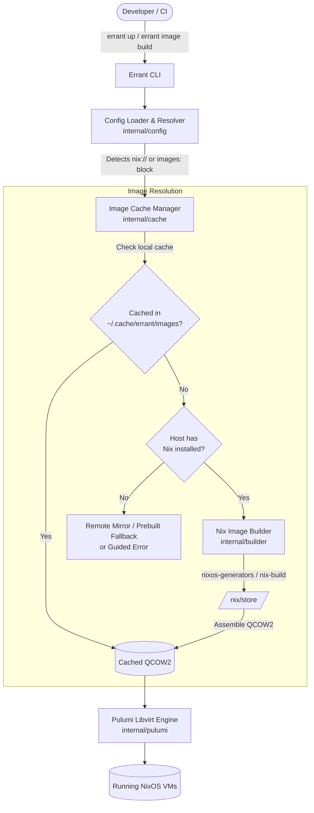

# Declarative NixOS Image Generation & Errantfile Integration Plan

## 1. Executive Summary

Upstream NixOS channels (`channels.nixos.org`) do not distribute pre-compiled `genericcloud` QCOW2 images like Ubuntu or Debian; they only host installation ISOs (`latest-nixos-minimal-x86_64-linux.iso`). Attempting to pull `https://channels.nixos.org/nixos-26.05/latest-nixos-genericcloud-x86_64-linux.qcow2` returns HTTP 404.

However, NixOS is inherently declarative and reproducible. Utilizing `nixos-generators` with the `qcow` format (combined with `services.cloud-init.enable = true` and `services.openssh.enable = true`) on a NixOS or Nix-enabled host allows building a ready-to-boot QCOW2 disk image in **30–60 seconds** with zero intermediate conversions, leveraging the host's `/nix/store` and `cache.nixos.org`.

### Critical Findings from Live Hypervisor Testing:
1. **`format: qcow` vs `format: openstack`**:
   - `openstack` format includes an upstream metadata service fetcher (`openstack-init`) that blocks attempting to reach `169.254.169.254`. Furthermore, it routes console to `tty1` (VGA) rather than `ttyS0`.
   - `qcow` format cleanly sets `console=ttyS0` (enabling standard `virsh console` serial access), excludes vendor metadata HTTP daemons, and pairs seamlessly with cloud-init NoCloud ISOs.
2. **OpenSSH Default**: In standard NixOS, `services.openssh.enable` defaults to `false`. Base generator configurations must explicitly declare `services.openssh.enable = true` for port 22 to accept connections.

This document specifies the architectural plan to integrate declarative NixOS image generation natively into **Errant** and the **`Errantfile.yaml`** specification, moving from manual out-of-band builds to seamless, declarative base image management.

---

## 2. Architecture & Design Principles



### Core Invariants
1. **Local-First & Transparent**: If `box: nixos/26.05` is specified and no cached image exists, Errant automatically detects `nix`, generates the OpenStack/cloud-init QCOW2 image, and stores it in the cache without requiring manual user intervention.
2. **Deterministic Cache Keys**: Images are cached by content hash or channel revision (e.g. `nixos-26.05-<hash>.qcow2`), preventing redundant rebuilds.
3. **Zero Runtime Delay**: VMs boot immediately from thin COW overlays on top of the generated base QCOW2 image, with cloud-init NoCloud ISO injecting networking and SSH credentials.
4. **Strict Modularity**: All Go builder code resides strictly in `internal/builder` or `internal/cache` (never `pkg/`).

---

## 3. Errantfile Specification Extensions

We propose two complementary integration surfaces in `Errantfile.yaml`:

### 3.1 Level 1: Shorthand `box: nixos/*` and `nix://` URIs
For users who want standard NixOS cloud images without maintaining custom Nix configurations:

```yaml
version: "1"
project: homelab-nixos

defaults:
  box: nixos/26.05       # Automatically builds/resolves openstack cloud image for 26.05
  driver: libvirt
  memory_mb: 2048
  cpus: 2

topologies:
  dev:
    nodes:
      - name: nix-node-1
        ip: 192.168.61.10
```

Alternatively, direct URI syntax for specific channels, flakes, or formats:
```yaml
defaults:
  image: nix://channel:nixos-26.05?format=openstack
  # or from a flake:
  # image: nix://flake:nixpkgs#nixos-26.05?format=openstack
```

### 3.2 Level 2: Declarative Root `images:` Block
For users who need custom base images with pre-baked packages, kernel modules, or hardened settings (bypassing slow post-boot provisioning):

```yaml
version: "1"
project: homelab-nixos

images:
  nixos-k8s-node:
    builder: nixos-generators     # "nixos-generators" or "nix"
    channel: nixos-26.05          # or flake: "github:NixOS/nixpkgs/nixos-26.05"
    format: openstack             # "openstack" (cloud-init), "qcow", or "raw-efi"
    packages:
      - vim
      - git
      - curl
      - ethtool
      - socat
    modules:
      - ./images/k8s-base.nix
    inline: |
      networking.firewall.enable = false;
      boot.kernelModules = [ "overlay" "br_netfilter" ];
      services.openssh.enable = true;

topologies:
  dev:
    nodes:
      - name: control-plane
        image: nixos-k8s-node
        ip: 192.168.61.10
```

### 3.3 Embedded Errant Base Profile (`errant-base.nix`)
Stock `nixos-generators` openstack format does not enable `services.openssh.enable = true;` by default (it only sets `PermitRootLogin = "yes"` conditionally). In standard NixOS, `sshd` defaults to disabled.

Therefore, when Errant executes an automatic build for `box: nixos/*`, it will inject an embedded `errant-base.nix` module:
```nix
{ pkgs, ... }:
{
  services.openssh = {
    enable = true;
    settings.PermitRootLogin = "prohibit-password";
  };
  services.cloud-init.enable = true;
  networking.firewall.enable = false;
  environment.systemPackages = [
    pkgs.vim
    pkgs.curl
    pkgs.git
  ];
}
```

This guarantees that any auto-generated NixOS image boots with OpenSSH active and cloud-init ready to accept keys on port 22 immediately.

---

## 4. Technical Implementation Plan

### Phase 1: Zero-Config Auto-Builder in `internal/cache`
**Goal**: Make `box: nixos/26.05` work immediately on any host with `nix` installed.

1. **Update `internal/config/box_resolver.go`**:
   - Change `nixos/26.05` and `nixos/24.11` aliases from 404 HTTP URLs to canonical URI identifiers:
     * `nixos/26.05` -> `nix://channel:nixos-26.05?format=openstack`
     * `nixos/24.11` -> `nix://channel:nixos-24.11?format=openstack`
2. **Implement `internal/cache/nix_builder.go`**:
   - Parse `nix://` URIs:
     * Format: `nix://channel:<channel>?format=<format>` or `nix://flake:<ref>?format=<format>`
   - Check cache:
     * Look up `~/.cache/errant/images/nixos-<channel>-<format>.qcow2`.
     * If file exists and size > 0, return immediately.
   - Builder execution:
     * Check if `nix` exists in `$PATH`. If not, return an informative error.
     * Execute `nix run nixpkgs#nixos-generators -- --format openstack -I nixpkgs=channel:<channel> -o <targetPath>`.
     * Stream build logs or display progress spinner to stderr.
3. **Unit Tests**:
   - Test URI parsing (`parseNixURI`).
   - Mock command execution for builder invocation.

### Phase 2: Declarative `images:` Schema & Config Resolution
**Goal**: Allow `Errantfile.yaml` to specify custom NixOS and container-derived images.

1. **Update `internal/config/types.go`**:
   ```go
   type ImageBuildConfig struct {
       Builder   string   `yaml:"builder" json:"builder"`     // "nixos-generators", "nix", "script"
       Channel   string   `yaml:"channel,omitempty" json:"channel,omitempty"`
       Flake     string   `yaml:"flake,omitempty" json:"flake,omitempty"`
       Format    string   `yaml:"format,omitempty" json:"format,omitempty"`   // defaults to "openstack"
       Packages  []string `yaml:"packages,omitempty" json:"packages,omitempty"`
       Modules   []string `yaml:"modules,omitempty" json:"modules,omitempty"`
       Inline    string   `yaml:"inline,omitempty" json:"inline,omitempty"`
       Source    string   `yaml:"source,omitempty" json:"source,omitempty"`
   }

   type Config struct {
       // ... existing fields ...
       Images map[string]ImageBuildConfig `yaml:"images,omitempty" json:"images,omitempty"`
   }
   ```
2. **Update JSON Schemas**:
   - Update `schema/errantfile.schema.json` and `internal/config/schema.json` with strict validation for `images`.
3. **Update `internal/config/resolver.go`**:
   - When a node's `image:` or `profile.image` matches a key in `images:`, resolve it via the builder engine before passing to Pulumi.

### Phase 3: Dedicated CLI Commands (`errant image`)
**Goal**: Provide first-class CLI commands for managing base images.

1. **Subcommands**:
   - `errant image list`: Shows all cached images in `/var/cache/xeno/errant/images/` or `~/.cache/errant/images/`, indicating source, format, size, and last modified date.
   - `errant image build [name]`: Pre-builds an image declared in `Errantfile.yaml` without spinning up VMs.
   - `errant image prune`: Cleans up unreferenced or temporary `.part` image files.
2. **UX Enhancements**:
   - Pretty-printed Lipgloss tables matching Errant's existing design system.

### Phase 4: Non-Nix Host Fallbacks & Homelab Mirror
**Goal**: Seamless experience on non-Nix Linux hosts (Ubuntu, Debian, Fedora, Arch).

1. **Detection & Actionable Diagnostics**:
   - If a user runs `errant up` with a `nix://` image on a host without `nix`:
     ```text
     Error: Nix is required to generate base image 'nixos-26.05'
     Tip: You can install Nix via:
          sh <(curl -L https://nixos.org/nix/install) --daemon
     Or point to a prebuilt image URL:
          defaults:
            image: https://homelab-mirror.local/images/nixos-26.05.qcow2
     ```
2. **Optional Homelab Mirror Configuration**:
   - Support `ERRANT_IMAGE_MIRROR` or `defaults.mirror:` in `Errantfile.yaml` to fetch pre-compiled NixOS QCOW2 images if local building is not desired.

---

## 5. Verification & Test Plan

1. **Unit Tests**:
   - `internal/config/config_test.go`: Validate parsing and schema rejection of invalid `images:` blocks.
   - `internal/cache/cache_test.go`: Test `nix://` URI detection and cache hit/miss behavior.
2. **CLI Tests**:
   - `errant validate -f examples/nixos-deploy-rs/Errantfile.yaml` passes schema validation.
   - `errant image list` displays existing cached images (`debian-12`, `noble-server`, `nixos-26.05`).
3. **End-to-End Integration**:
   - Run `errant up` on `examples/nixos-deploy-rs/`.
   - Verify Libvirt domain starts, cloud-init executes, and SSH connects via `errant ssh nixos-sim`.
4. **Code Quality Gates**:
   - `golangci-lint run` passes with 0 issues.
   - `markdownlint-cli2 docs/NIXOS_IMAGE_GENERATION_PLAN.md` passes with 0 issues.
