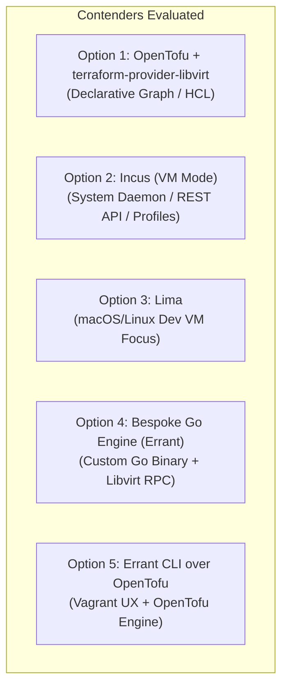

# Errant: Architecture & Implementation Plan
**A Modern, Free-Software Multi-Node Local Virtualization Orchestrator**

---

## 1. Executive Summary & Problem Statement

### 1.1 Context
HashiCorp has relicensed its core toolchain under the Business Source License (BSL 1.1) and is phasing out Vagrant Cloud/Atlas public image registry services. In addition:
* The legacy Vagrant codebase is tied to an aging Ruby runtime and complex C-extensions (`vagrant-libvirt`, `ruby-libvirt`, `fog-libvirt`) that regularly break across host Linux distribution upgrades.
* Vagrant's Turing-complete Ruby DSL leads to unmaintainable logic, slow SSH polling loops, fragile regex scraping of CLI tools, and insecure host privilege escalation (e.g., editing `/etc/exports` with `sudo` for NFS).
* The official HashiCorp Go rewrite (`vagrant-go`) stalled due to backwards-compatibility entanglements with legacy Ruby plugins.

### 1.2 Mission & Immediate Scope
The goal is to replace Vagrant in local development, continuous integration, and homelab environments—starting with the immediate target: [`os76-ansible/k8s-homelab`](/home/xeno/git/gitea/os76-ansible/k8s-homelab).

---

## 2. Architectural Contender Analysis (from `llm-wiki`)

The local knowledge base (`llm-wiki: vagrant-alternatives-and-vm-orchestration.md`) evaluated several modern successors for Linux/Libvirt virtualization:



### 2.1 Detailed Comparison Matrix

| Dimension | Option 1: OpenTofu + Libvirt | Option 2: Incus (VM Mode) | Option 3: Lima | Option 4: Bespoke Go Errant | Option 5: Errant CLI over OpenTofu |
|---|---|---|---|---|---|
| **License** | MPL 2.0 (Open Source) | Apache 2.0 (Open Source) | Apache 2.0 (Open Source) | MPL 2.0 / MIT | MPL 2.0 / MIT |
| **Topology Engine** | Declarative DAG / HCL | CLI / Profiles / Scripts | Individual YAML files | Custom YAML schema + Go runner | YAML $\rightarrow$ OpenTofu DAG |
| **State & Rollbacks** | Native `.tfstate` + DAG rollback | Daemon SQLite state | File-based instance store | Custom state tracker (to build) | Handled by OpenTofu engine |
| **Hypervisor Interface**| Compiled Go Libvirt provider | Direct QEMU / KVM process | Direct QEMU / VZ | Direct pure-Go Libvirt RPC | Via OpenTofu Libvirt provider |
| **Multi-Node Topologies**| Native `count`, `for_each`, modules | Profiles + shell loops | Independent VMs (cumbersome) | Native array & profile resolver | Native HCL modules |
| **Cloud-Init & Disks** | `libvirt_cloudinit_disk` + COW volumes | Built-in cloud-init support | Native cloud-init support | Custom ISO9660 + qemu-img wrapper | Handled by OpenTofu provider |
| **Shared Folders** | `virtiofs` XML definition | Native `incus config device` | Native virtiofs mount | Injected virtiofs XML domain | Handled by OpenTofu provider |
| **SSH Ergonomics** | Needs generated `.ssh_config` | Native `incus exec` (socket) | Native `limactl shell` | Native `errant ssh` command | Native `errant ssh` wrapper |
| **Ansible Integration** | Emits `inventory.ini` via `local_file`| Dynamic inventory plugin | Ad-hoc | Auto-generated `inventory.ini` | Auto-generated `inventory.ini` |
| **New Code to Maintain**| **0 lines** (pure HCL configuration) | Minor config scripts | Low | **High** (~4,000–8,000 lines Go) | **Low** (~800–1,500 lines Go) |

---

## 3. Deep-Dive: OpenTofu vs. Bespoke Custom Schema

### 3.1 The OpenTofu + `terraform-provider-libvirt` Case
OpenTofu is already a proven, declarative, open-source infrastructure-as-code engine. It directly addresses the problems of Vagrant:
1. **Already Declarative**: HCL natively provides dependency graphs, variable validation, conditionals, and iteration (`for_each`).
2. **Zero Schema Reimplementation**:
   * `libvirt_volume`: Thin QCOW2 COW overlays backed by cached base images (`base_volume_name` or `source`).
   * `libvirt_cloudinit_disk`: Assembles `user_data`, `meta_data`, and `network_config` into a NoCloud ISO automatically.
   * `libvirt_domain`: Manages vCPU, RAM, virtio interfaces, disks, and `virtiofs` shared folders without raw XML generation.
   * `libvirt_network`: Creates isolated private bridge/NAT networks and sets DHCP reservations.
3. **Robust State & Rollbacks**: If node 2 fails while creating a 3-node cluster, OpenTofu cleans up or reports exact delta state. In a custom engine, state recovery, partial teardown, and locking must be engineered from scratch.
4. **Existing Homelab Synergy**: OpenTofu is already used across the user's infrastructure.

### 3.2 Where Pure OpenTofu Lacks Vagrant's Developer UX
1. **Developer Ergonomics**:
   * Vagrant: `vagrant ssh kube-control-plane` (instant interactive PTY).
   * OpenTofu: No native shell command. The developer must inspect output IPs, write a `.ssh_config`, and run `ssh -F .ssh_config kube-control-plane`.
2. **Lifecycle Command Familiarity**:
   * Vagrant: `vagrant up`, `vagrant halt`, `vagrant destroy`, `vagrant status`, `vagrant provision`.
   * OpenTofu: `tofu apply -auto-approve`, `tofu destroy -auto-approve`. Shutting down a VM without destroying its disk (`vagrant halt`) requires state manipulation or targeted attributes in HCL.
3. **Sequential Provisioning Hooks**:
   * OpenTofu's `remote-exec` / `local-exec` provisioners are officially treated as a last resort and have limited output streaming and debugging capabilities compared to dedicated provisioners.

---

## 4. The Three Viable Architectural Paths for Errant

```
┌────────────────────────────────────────────────────────────────────────┐
│ Path A: Pure OpenTofu Module (Zero new software to build)              │
│ - Write a reusable OpenTofu module: modules/errant-libvirt             │
│ - Driven by standard Makefile targets in k8s-homelab                   │
│ - OpenTofu outputs .ssh_config and inventory.ini                       │
├────────────────────────────────────────────────────────────────────────┤
│ Path B: Errant as a Thin Go CLI Orchestrator over OpenTofu (Hybrid)    │
│ - Errant CLI parses a clean YAML file (profiles, topologies)           │
│ - Synthesizes HCL and invokes OpenTofu in-process or via CLI           │
│ - Provides 'errant up', 'errant ssh', 'errant halt', 'errant status'   │
├────────────────────────────────────────────────────────────────────────┤
│ Path C: Errant as a Standalone Go Binary (Direct Libvirt RPC)          │
│ - Complete custom Go implementation with custom YAML schema            │
│ - Direct libvirt Go RPC client (no OpenTofu or external dependencies)  │
│ - Full control over domain XML, ISO generation, and lifecycle steps    │
└────────────────────────────────────────────────────────────────────────┘
```

---

## 5. Architectural Decision Log & Current Implementation

The following concrete architectural decisions have been made, implemented, and validated in the codebase:

### Decision 1: Adoption of Path B
* **Selected Path**: **Path B (Hybrid Orchestrator)**.
* **Rationale**: Provides the best developer experience (single Go CLI binary, interactive `ssh`, `up`, `status`, `halt`, `destroy`) without incurring the high maintenance cost of maintaining custom hypervisor RPC, storage pools, or two-way state rollback graphs.

### Decision 2: Mandatory `internal/` Package Placement
* **Decision**: All Go modules MUST reside within `internal/` (`internal/config`, `internal/generator`, `internal/tofu`, `internal/cli`, `internal/wizard`).
* **Rationale**: Enforces encapsulation and prevents leaking internal abstractions as public libraries (`pkg/` is strictly prohibited).

### Decision 3: JSON Schema & Declarative YAML Specification
* **Decision**: Author and embed a canonical Draft 2020-12 JSON Schema (`schema/errantfile.schema.json`).
* **Rationale**: Guarantees fast, compile-time and runtime validation of `Errantfile.yaml` topologies with IDE autocompletion. Supports profile inheritance, template indexing (`${index}`), auto-incrementing IPs (`ip_start`), and conditional attached disks.

### Decision 4: Native NixOS Virtualization (No Debian Stub)
* **Decision**: Local NixOS VMs boot directly from native NixOS genericcloud QCOW2 images via thin COW overlays and cloud-init NoCloud ISOs.
* **Rationale**: The intermediate Debian bootstrap and `nixos-anywhere` conversion pipeline was purely an `os76-public` workaround for cloud VPS API limitations. In local Libvirt/KVM environments, NixOS cloud images boot out-of-the-box.

### Decision 5: Interactive Charmbracelet Terminal Wizard (`errant init`)
* **Decision**: Implement an interactive terminal wizard in `internal/wizard` using Charmbracelet Bubble Tea, Lipgloss, and Bubbles.
* **Rationale**: Allows developers to scaffold valid `Errantfile.yaml` configurations interactively across multiple archetypes (`k8s-cluster`, `k8s-ha`, `single-vm`, `custom`) with curated OS images (Ubuntu 24.04, Debian 12, NixOS genericcloud, Alpine). Also provides non-interactive/scriptable automation via `errant init -y`.

### Decision 6: Reproducible Toolchain & Binary Destination
* **Decision**:
  - Development environment managed via Nix (`shell.nix`) and direnv (`.envrc`).
  - Compiled binaries output directly to `dist/errant` via `./build.sh` or `go build -o dist/errant .`.

### Decision 7: Strict Static Analysis & High Test Coverage
* **Decision**:
  - Imported strict `.golangci.yml` from `https-wrench` enforcing `revive`, `wsl_v5`, `gofumpt`, and complexity limits (< 15).
  - Maintained **>90% test statement coverage** (currently 91.2% total, >90% across every package in `internal/`).

---

## 6. Implementation Milestones & Roadmap

- [x] **Milestone 1: Core Configuration Engine**
  - Schema definition (`schema/errantfile.schema.json`).
  - Embedded YAML validator & resolver (`internal/config`).
  - Profile inheritance, dynamic `${index}` interpolation, and disk conditions.
- [x] **Milestone 2: Artifact Generation**
  - OpenTofu JSON generator declaring libvirt domains, volumes, networks, and cloud-init disks (`internal/generator/tofu.go`).
  - OpenSSH client config generator (`internal/generator/ssh.go`).
  - Ansible INI inventory generator (`internal/generator/inventory.go`).
- [x] **Milestone 3: Process Runner & CLI Frontend**
  - OpenTofu lifecycle executor (`internal/tofu/runner.go`).
  - Cobra CLI commands: `up`, `status`, `ssh`, `halt`, `destroy`, `ssh-config`, `inventory`, `validate` (`internal/cli`).
- [x] **Milestone 4: Interactive Bubble Tea Wizard**
  - Interactive archetype and OS image selector (`internal/wizard`).
  - `errant init` / `errant wizard` CLI command.
- [x] **Milestone 5: Testing & Quality Assurance**
  - Unit test suites exceeding 90% statement coverage across all packages.
  - Zero linter warnings under strict `.golangci.yml`.
  - Managed git hooks installed and validated (`golangci-lint`, `shellcheck`, `nix`, `markdown`, `yaml`, `gitleaks`, `commit-msg`).
- [ ] **Milestone 6: Advanced Capabilities (Future)**
  - Multi-hypervisor backends via OpenTofu (Proxmox, Incus, AWS).
  - VM snapshotting and rollback commands (`errant snapshot save/restore`).
