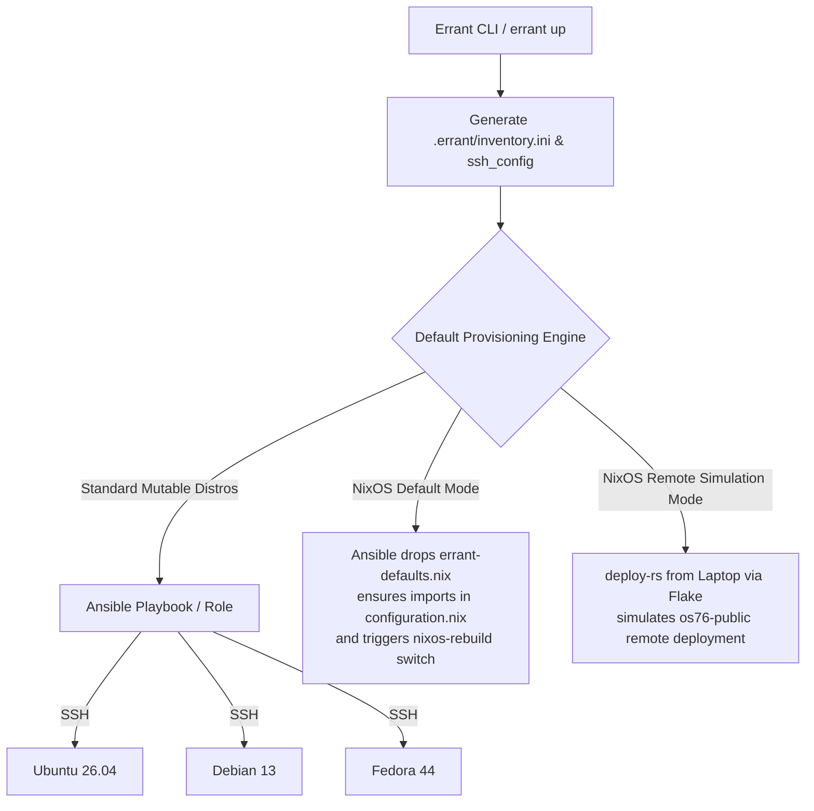

# Guest Base Image Environment & Terminal Provisioning Plan

## 1. Executive Summary

During the development of the `k8s-homelab` reference topology, several crucial guest environment optimizations were introduced to resolve common developer frustrations when SSH-ing into minimal cloud images. These include broken backspaces/colors under non-standard host terminals, missing syntax highlighting, default `nano` editors interrupting Git/Kubernetes workflows, and suboptimal YAML formatting.

This document inventories those optimizations and establishes a plan to generalize them into a reusable, cross-distribution provisioning mechanism for all Errant VM images (**Ubuntu**, **Debian**, **Fedora**, and **NixOS**), evaluating **Ansible**, **deploy-rs / NixOS declarations**, and **cloud-init**.

---

## 2. Inventory of Current Optimizations (`k8s-homelab`)

The optimizations currently implemented in `examples/k8s-homelab/scripts/common.sh` and `control-plane-tools.sh` fall into three functional categories:

### 2.1 Terminal Capabilities & 256-Color Fallback
* **Problem**: Minimal vendor cloud images often lack complete terminfo databases. When host terminals like `alacritty`, `kitty`, `wezterm`, or `xterm-ghostty` connect, remote curses applications fail, colors break, or `$TERM` degrades to `dumb`.
* **Current Solution** (`/etc/profile.d/term.sh`):
  ```bash
  if [ -n "$PS1" ] || [ -t 0 ]; then
    if [ "$TERM" = "dumb" ] || [ -z "$TERM" ] || ! infocmp "$TERM" >/dev/null 2>&1; then
      export TERM=xterm-256color
    fi
  fi
  ```
* **Packages**: `bash-completion` and terminfo definitions (`ncurses-term`).

### 2.2 System Editor & Environment Variables
* **Problem**: Debian/Ubuntu default to `nano`. Non-interactive tools or subshells often lack `$EDITOR` / `$VISUAL`, causing `kubectl edit`, `crontab -e`, and `git commit` to fail or trigger an unfamiliar editor.
* **Current Solution**:
  * System-wide alternative: `update-alternatives --set editor /usr/bin/vim.basic`.
  * Login/interactive shell exports (`/etc/profile.d/editor.sh`):
    ```bash
    export EDITOR=vim
    export VISUAL=vim
    ```
  * Non-interactive persistence: Appended to `/etc/environment` (`EDITOR=vim`, `VISUAL=vim`).

### 2.3 Vim YAML & Dark Background Defaults
* **Problem**: Stock `vim` on fresh images lacks line numbers, sets 8-character hard tabs, has syntax highlighting disabled, and renders poor contrast on modern dark terminal themes.
* **Current Solution** (`/etc/vim/vimrc.local`):
  ```vim
  syntax on
  set background=dark
  set tabstop=2
  set shiftwidth=2
  set expandtab
  set number
  autocmd FileType yaml setlocal ts=2 sts=2 sw=2 expandtab
  ```

### 2.4 CLI Aesthetics & Themed Tooling (Control Plane)
* **`glow` Markdown Reader**: Installed with Tokyo-Night styling (`alias glow="glow -s tokyo-night -w 150"` in `/etc/profile.d/glow.sh`).
* **`k9s` Terminal UI**: Deployed with a custom transparent Nord theme (`skins/nord.yaml`) ensuring clean background rendering over SSH sessions.

---

## 3. Cross-Distribution Mapping

Each target Linux distribution handles system configuration, packages, and immutable configs differently:

| Optimization | Ubuntu / Debian | Fedora Cloud | NixOS |
| :--- | :--- | :--- | :--- |
| **Editor Binary** | `vim` / `vim-basic` | `vim-enhanced` | `pkgs.vim` |
| **System Alternative** | `update-alternatives` | `update-alternatives` | Declarative `environment.variables.EDITOR` |
| **Environment** | `/etc/environment`, `/etc/profile.d/` | `/etc/environment`, `/etc/profile.d/` | `environment.variables`, `environment.sessionVariables` |
| **Vim Global Config** | `/etc/vim/vimrc.local` | `/etc/vimrc` or `/etc/vimrc.local` | `programs.vim.settings` / `programs.vim.extraConfig` |
| **256-Color Fallback**| `/etc/profile.d/term.sh` | `/etc/profile.d/term.sh` | `environment.extraInit` |
| **Bash Completion** | `bash-completion` | `bash-completion` | `programs.bash.completion.enable = true` |

---

## 4. Provisioning Method Evaluation



### 4.1 Ansible (Primary Unified Orchestrator)
* **Pros**:
  * Errant **already** auto-generates `.errant/inventory.ini` and `.errant/ssh_config`.
  * Multi-distro support out of the box via OS family filters (`ansible_os_family`).
  * Agentless (pure SSH + Python).
  * Familiar syntax to homelab and enterprise operators.
* **Can Ansible configure NixOS? How does `errant-defaults.nix` stay in sync with `configuration.nix`?**
  * In standard NixOS, `nixos-rebuild switch` reads `/etc/nixos/configuration.nix`.
  * Dropping `/etc/nixos/errant-defaults.nix` alone is insufficient unless referenced in `configuration.nix`.
  * **Sync Mechanism**: Ansible uses a two-step idempotent task:
    1. Uploads `/etc/nixos/errant-defaults.nix`.
    2. Ensures `/etc/nixos/configuration.nix` includes `./errant-defaults.nix` within its `imports = [ ... ];` block (via `ansible.builtin.lineinfile` or a templated modular `configuration.nix`).
    3. Runs `nixos-rebuild switch`.
  * This guarantees `errant-defaults.nix` is fully evaluated as part of the live system closure. If evaluation fails (e.g., syntax error), NixOS rolls back automatically without altering running state.

### 4.2 deploy-rs for NixOS Simulation (The `os76-public` Workflow)
* **Role**: Optional, advanced workflow to simulate remote NixOS server updates from laptops/workstations before production deployments.
* **Why it is important**:
  * In `os76-public`, `deploy-rs` is used to deploy NixOS configurations remotely to physical/cloud nodes via SSH.
  * Developers need a fast, local, reproducible KVM testbed to validate `deploy-rs` flake configurations, activation scripts, and rollbacks on their laptops without touching live infrastructure.
* **How Errant enables this**:
  1. Errant boots a clean NixOS VM (`examples/nixos` or `examples/nixos-deploy-rs`).
  2. Errant outputs `.errant/ssh_config` specifying the guest IP, SSH key, and user (`errant`).
  3. A local `flake.nix` defining `deploy.nodes.nixos-vm` consumes the generated SSH config:
     ```nix
     deploy.nodes.nixos-vm = {
       hostname = "192.168.60.10";
       profiles.system = {
         user = "root";
         sshUser = "errant";
         sshOpts = [ "-F" ".errant/ssh_config" ];
         path = deploy-rs.lib.x86_64-linux.activate.nixos self.nixosConfigurations.nixos-vm;
       };
     };
     ```
  4. The developer executes `deploy .#nixos-vm` locally to simulate the exact production rollout.
* **Action Item**: We will provide a dedicated reference example `examples/nixos-deploy-rs/` proving this end-to-end.

### 4.3 Cloud-Init NoCloud Injection [POSTPONED]
* **Mechanism**: Use `write_files:` inside the cloud-init NoCloud ISO attached to each VM to inject `/etc/profile.d/` scripts and `/etc/vim/vimrc.local` during initial boot.
* **Status**: **Postponed for the current phase**. Kept in the plan for future zero-dependency / zero-SSH baselining once the Ansible role and `deploy-rs` examples are verified.

---

## 5. Proposed Architecture: Unified Defaults via Ansible Role

We propose creating a reusable Ansible role: `provisioning/roles/errant_guest_defaults`:

```
provisioning/
├── defaults.yaml               # Top-level playbook targeting all nodes
└── roles/
    └── errant_guest_defaults/
        ├── tasks/
        │   ├── main.yaml       # OS dispatcher (Ubuntu, Debian, Fedora, NixOS)
        │   ├── debian.yaml     # Ubuntu / Debian specifics (apt, update-alternatives)
        │   ├── redhat.yaml     # Fedora specifics (dnf, /etc/vimrc)
        │   └── nixos.yaml      # NixOS sync (errant-defaults.nix + imports + nixos-rebuild)
        ├── templates/
        │   ├── term.sh.j2      # 256-color auto-detection
        │   ├── editor.sh.j2    # EDITOR=vim, VISUAL=vim
        │   ├── vimrc.local.j2  # YAML tabs, numbers, dark background
        │   └── errant-defaults.nix.j2 # NixOS declarative equivalent
        └── handlers/
            └── main.yaml
```

### 5.1 NixOS Task in Ansible (`tasks/nixos.yaml`)
```yaml
---
- name: Deploy Errant defaults NixOS module
  ansible.builtin.template:
    src: errant-defaults.nix.j2
    dest: /etc/nixos/errant-defaults.nix
    mode: "0644"
  register: nixos_defaults_module

- name: Ensure errant-defaults.nix is imported in configuration.nix
  ansible.builtin.lineinfile:
    path: /etc/nixos/configuration.nix
    insertafter: 'imports\s*=\s*\['
    line: '    ./errant-defaults.nix'
  register: nixos_config_import

- name: Rebuild and switch NixOS configuration
  ansible.builtin.command:
    cmd: nixos-rebuild switch
  when: nixos_defaults_module.changed or nixos_config_import.changed
```

### 5.2 NixOS Module Content (`errant-defaults.nix.j2`)
```nix
{ config, pkgs, ... }:

{
  environment.systemPackages = with pkgs; [
    vim
    bash-completion
    ncurses
    socat
  ];

  environment.variables = {
    EDITOR = "vim";
    VISUAL = "vim";
  };

  programs.vim.defaultEditor = true;
  programs.vim.settings = {
    number = true;
    background = "dark";
    tabstop = 2;
    shiftwidth = 2;
    expandtab = true;
  };
  programs.vim.extraConfig = ''
    syntax on
    autocmd FileType yaml setlocal ts=2 sts=2 sw=2 expandtab
  '';

  programs.bash.completion.enable = true;

  environment.extraInit = ''
    if [ -n "$PS1" ] || [ -t 0 ]; then
      if [ "$TERM" = "dumb" ] || [ -z "$TERM" ] || ! ${pkgs.ncurses}/bin/infocmp "$TERM" >/dev/null 2>&1; then
        export TERM=xterm-256color
      fi
    fi
  '';
}
```

---

## 6. Implementation Roadmap

### Phase 1: Reusable Ansible Defaults Role
1. Create `provisioning/defaults.yaml` and `provisioning/roles/errant_guest_defaults/`.
2. Implement task branches for:
   * `Debian` (Ubuntu, Debian): apt packages, `/etc/profile.d/`, `/etc/vim/vimrc.local`, `update-alternatives`.
   * `RedHat` (Fedora): dnf packages, `/etc/profile.d/`, `/etc/vimrc`.
   * `NixOS`: `/etc/nixos/errant-defaults.nix` template, `imports` wiring in `configuration.nix`, `nixos-rebuild switch`.
3. Validate against running single-VM topologies (`examples/fedora`, `examples/ubuntu`, `examples/debian`, `examples/nixos`).

### Phase 2: NixOS `deploy-rs` Simulation Example (`examples/nixos-deploy-rs`)
1. Create `examples/nixos-deploy-rs/` reference topology.
2. Provide a self-contained `flake.nix` with `deploy-rs` configuration targeting the local VM.
3. Document how developers can use Errant to test `deploy-rs` activations, system closures, and rollbacks on their local laptops before pushing to `os76-public` or cloud servers.

### Phase 3: Errant CLI Native Provisioner Support
1. Extend `internal/provisioner` to support an `ansible` provisioner type in `Errantfile.yaml`:
   ```yaml
   defaults:
     provision:
       - type: ansible
         playbook: provisioning/defaults.yaml
   ```
2. Automatically invoke `ansible-playbook` with generated `.errant/inventory.ini` and `.errant/ssh_config`.

### Phase 4 (Postponed): Cloud-Init NoCloud ISO Direct Injection
1. Investigate injecting baseline environment scripts into the generated NoCloud ISO `user-data` for zero-SSH instant boot defaults.

---

## 7. Decision Summary

| Component | Selected Strategy | Rationale |
| :--- | :--- | :--- |
| **Default Provisioner** | Ansible (`errant_guest_defaults`) | Cross-platform, agentless, leverages auto-generated inventory/SSH configs. |
| **NixOS Default Mode** | Ansible sync + `nixos-rebuild switch` | Idempotently wires `errant-defaults.nix` into `configuration.nix` imports. |
| **NixOS Remote Simulation** | `deploy-rs` in `examples/nixos-deploy-rs` | Emulates `os76-public` laptop-to-remote deployment pipeline locally. |
| **Cloud-Init NoCloud** | Postponed | Deferred to future phase after Ansible and deploy-rs are in place. |
